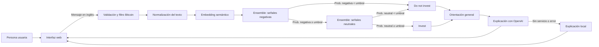

# Bitcoin Decision Chat

## 1. Resumen del proyecto

Bitcoin Decision Chat es un prototipo web educativo que analiza mensajes en inglés relacionados con Bitcoin. Combina clasificación de texto y una explicación generada por un asistente para mostrar una orientación general —«Invest» o «Do not invest»— a partir del lenguaje del mensaje. Está dirigido a personas interesadas en explorar cómo aplicar modelos de NLP a un caso financiero; su aportación principal es reunir inferencia, explicación y una interfaz sencilla en un mismo servicio. La orientación es experimental: no predice precios ni constituye asesoramiento financiero.

## 2. Problema y objetivos

Los mensajes de mercado expresan opiniones con contexto incompleto. El proyecto explora cómo transformar un texto sobre Bitcoin en una clasificación y explicación legible, dejando claros los límites de esa interpretación.

Los objetivos técnicos son aceptar mensajes de forma controlada, descartar textos sin una referencia reconocible a Bitcoin, estimar su orientación con modelos de clasificación y presentar una explicación que no convierta el tono textual en una predicción de mercado. También se busca mantener una respuesta cuando el proveedor de lenguaje falla.

## 3. Solución y arquitectura

El navegador ofrece ejemplos y un campo para introducir un mensaje. El servicio valida el texto, aplica normalización y comprueba que haya una referencia a Bitcoin. Después transforma el mensaje en una representación semántica y consulta dos ensembles de LightGBM en secuencia. El primer clasificador evalúa señales negativas y, cuando su probabilidad alcanza el umbral, el segundo valora señales neutrales. Los umbrales determinan la orientación devuelta. A continuación, un modelo de OpenAI redacta la explicación; sin credenciales o ante un fallo, se utiliza una respuesta local. La interfaz muestra el resultado y la advertencia informativa.

## 4. Desarrollo y decisiones técnicas

La aplicación está organizada como un servicio FastAPI que entrega tanto la interfaz estática como las respuestas de análisis. Esta elección mantiene el flujo de usuario y la inferencia en el mismo despliegue y evita colocar credenciales del proveedor de lenguaje en el navegador. El contrato de entrada restringe el mensaje a un máximo de 800 caracteres y rechaza entradas vacías. Una comprobación léxica requiere una referencia reconocible a Bitcoin o al mercado cripto antes de ejecutar el análisis.

La preparación del texto pasa a minúsculas, elimina enlaces, menciones y símbolos de ticker, conserva signos útiles y reduce repeticiones y espacios. Mantener una limpieza coherente es importante porque el clasificador trabaja sobre una representación derivada del texto, no sobre variables de mercado. Sentence Transformers genera el embedding semántico; los clasificadores LightGBM operan sobre esa representación. En lugar de una única etiqueta multiclase, la inferencia encadena dos ensembles. Si la probabilidad de la clase negativa queda por debajo de su umbral, devuelve «Do not invest»; si lo alcanza, evalúa el ensemble neutral. En esa segunda etapa, una probabilidad neutral igual o superior a su umbral da «Invest»; de lo contrario, la salida también es «Do not invest».

La explicación es una capa posterior a la clasificación, no el mecanismo que decide la orientación. Cuando OpenAI está configurado, recibe el texto original como dato no confiable junto con la etiqueta del modelo y debe explicar el resultado sin inventar probabilidades ni prometer rendimientos. Si la llamada falla o no hay clave, el sistema genera una explicación local. Esta alternativa evita que la disponibilidad del proveedor externo sea requisito para recibir un resultado. La respuesta mantiene explícita la incertidumbre del análisis.

Para el empaquetado, Docker prepara los artefactos y el modelo de embeddings durante la construcción, y el servicio los carga en modo sin conexión al arrancar. Se usa un único worker para contener la memoria duplicada de los modelos. FastAPI expone comprobaciones de salud; la aplicación incorpora límite de solicitudes, cabeceras de seguridad y una respuesta genérica ante errores internos. Estas decisiones incorporan aspectos de operación y protección de credenciales.

El proyecto conserva también una iteración de clasificación binaria de sentimiento positivo o negativo, con otro flujo de API y ajuste del umbral sobre validación. Es una línea distinta de la aplicación web secuencial y sus resultados no describen el rendimiento de esta.

## 5. Retos y soluciones

El flujo debe distinguir un mensaje sobre Bitcoin de texto ajeno al tema; el filtro previo rechaza este último antes del análisis. También desacopla la explicación de la disponibilidad del proveedor generativo mediante una respuesta local, y empaqueta el modelo de embeddings para que el arranque no dependa de una descarga externa. 

## 6. Evaluación y resultados

Las pruebas automatizadas cubren la entrega de la página, el estado de salud, las dos salidas de orientación y el rechazo de mensajes ajenos a Bitcoin. Los resultados históricos corresponden a experimentos de clasificación binaria y no miden el modelo secuencial de la aplicación web. Por tanto, todavía falta una evaluación predictiva documentada para el sistema actual.

## 7. Estado actual y futuras mejoras

El código configura una aplicación web y una API funcionales, carga los dos ensembles desde artefactos y ofrece una explicación generativa con alternativa local. El alcance sigue siendo experimental y depende de los datos y etiquetas de entrenamiento. El siguiente paso sería documentar el protocolo de cada clase y evaluar los modelos con mensajes recientes y representativos, midiendo errores y calibración por etapa. También convendría evaluar texto ambiguo, irónico o fuera de dominio.

