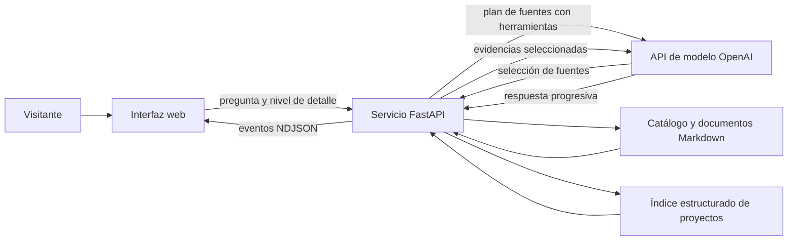

# Asistente profesional web para entrevistas

## 1. Resumen del proyecto

He creado una aplicación web conversacional que permite a reclutadores y otras personas interesadas consultar información profesional mediante preguntas en lenguaje natural. El asistente combina una interfaz de chat con un backend que busca evidencias en un conjunto curado de documentos y fichas de proyectos antes de generar cada respuesta. Su aportación principal es convertir un perfil profesional estructurado en una experiencia interactiva, con respuestas adaptables y controles para limitar la exposición de información.

## 2. Problema y objetivos

Un currículum presenta la información de forma fija y obliga a localizar manualmente la experiencia relevante para cada pregunta. Este proyecto busca facilitar una exploración contextual del perfil, mantener el hilo entre consultas y permitir iniciar, detener o reiniciar la conversación. También persigue objetivos de ingeniería: limitar las fuentes consultadas, gestionar carga y errores, y proteger las credenciales.

## 3. Solución y arquitectura

El visitante escribe una pregunta y selecciona el nivel de detalle. El servicio valida la solicitud, asigna una sesión y aplica límites de uso. Antes de responder, el modelo debe seleccionar fuentes con herramientas restringidas para leer documentos del catálogo o buscar fichas de proyectos. El backend ejecuta esas consultas, devuelve la evidencia al modelo y transmite la respuesta al navegador como eventos NDJSON. Las conversaciones completadas se conservan en memoria para aportar contexto a la siguiente pregunta.

## 4. Desarrollo y decisiones técnicas

El backend usa Python, FastAPI y Uvicorn. La integración con OpenAI emplea la API Responses y herramientas de función con esquemas cerrados. La selección de fuentes es obligatoria: si el modelo no propone consultas válidas, la planificación falla. Así se separa la decisión sobre qué consultar de la lectura, que ejecutan funciones locales.

La información reside en documentos Markdown descritos por un catálogo YAML y un índice estructurado de proyectos. La resolución de fuentes restringe las lecturas a la colección permitida. El buscador de proyectos normaliza términos y tildes, cuenta coincidencias en campos priorizados y aplica reglas editoriales para temas concretos. Es una estrategia determinista léxica, no vectorial. En documentos extensos, el sistema divide por encabezados y selecciona secciones que coinciden con la pregunta hasta un límite de contexto.

El modelo es configurable y el código establece `gpt-5.5` como valor predeterminado. La salida ofrece tres niveles de detalle y se transmite por streaming. Si queda incompleta, el backend puede pedir una continuación. Un saneador retiene un margen entre fragmentos para detectar patrones sensibles que crucen sus límites.

El cliente usa HTML, CSS y JavaScript sin framework; gestiona streaming, cancelación, reinicio y preferencia visual. Una cookie `HttpOnly` identifica la sesión; el historial queda en la memoria del proceso y tiene límites de tamaño. El servicio valida solicitudes, limita uso y concurrencia, ordena la cola y aplica cabeceras de seguridad. La clave permanece en el backend. PostHog es opcional y requiere configuración y consentimiento, con captura automática y grabación de sesiones desactivadas.

La imagen Docker usa una base Python ligera y un usuario sin privilegios. No constan comparativas controladas entre modelos, proveedores o estrategias alternativas.

## 5. Retos y soluciones

Un reto es recuperar evidencia útil sin enviar toda la documentación al modelo. El catálogo orienta la selección de fuentes, el índice devuelve fichas compactas y los documentos largos se reducen a secciones coincidentes. La resolución acotada y los campos públicos permitidos limitan el acceso y la información devuelta.

El streaming plantea retos de continuidad y privacidad: pueden producirse errores tras mostrar parte de una respuesta o dividirse un dato sensible entre fragmentos. El cliente conserva respuestas parciales; el backend guarda en historial solo respuestas completadas y mantiene texto en búfer antes de emitirlo. La cola y los límites de peticiones gestionan la capacidad frente a una API externa.

## 6. Evaluación y resultados

El repositorio incluye pruebas unitarias para catálogo, búsqueda, sesiones, cola, cabeceras, streaming, errores y saneamiento, además de regresiones simuladas para respuestas incompletas.

El proyecto ofrece tres niveles de respuesta y configura dos generaciones simultáneas con hasta veinte consultas adicionales en cola FIFO; son parámetros de capacidad, no resultados de una prueba de carga. No constan evaluación con usuarios, preguntas etiquetadas, comparativa de calidad, latencia bajo carga ni métricas de precisión o recuperación. La calidad percibida y el rendimiento real quedan por medir.

## 7. Estado actual y futuras mejoras

La implementación reúne interfaz, servicio, fuentes estructuradas, generación conectada a OpenAI, streaming y contenedor. La documentación y el índice del proyecto registran un despliegue público en DigitalOcean App Platform; la disponibilidad actual no se ha verificado. Las sesiones y la concurrencia son locales a una instancia; escalar a varias réplicas requiere compartir el estado. Coste y latencia también dependen del proveedor externo.

Como siguiente etapa, propongo medir recuperación y calidad con preguntas representativas y revisar latencia bajo carga. También sería posible externalizar sesiones para escalar y evaluar recuperación semántica si las pruebas muestran límites de la búsqueda léxica. Son líneas futuras, no funcionalidades ya implementadas.
