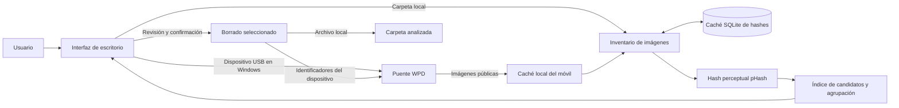

# TwinPhoto — Fotos parecidas V3

## 1. Resumen del proyecto

TwinPhoto es una aplicación de escritorio para localizar fotografías visualmente parecidas en carpetas locales y, en Windows, en galerías públicas de dispositivos conectados por USB. Está dirigida a personas que quieren revisar colecciones grandes y encontrar duplicados o variantes antes de decidir qué conservar. Su aportación principal es combinar comparación perceptual, reutilización de caché y revisión visual con una acción de borrado explícita, evitando que el análisis modifique los originales.

## 2. Problema y objetivos

Las colecciones fotográficas acumulan copias redimensionadas, recomprimidas o editadas que no se detectan comparando nombres o tamaños. Revisarlas una a una consume tiempo, y una eliminación automática por similitud puede descartar una imagen que el usuario quería conservar. En móviles, el acceso MTP puede ser lento y depende de lo que Windows exponga.

El objetivo fue agrupar imágenes según su apariencia, facilitar su revisión y dejar la decisión final a la persona. Los análisis repetidos reutilizan resultados y el acceso móvil conserva copias temporales e inventario. El alcance es una aplicación de escritorio para Windows y carpetas locales.

## 3. Solución y arquitectura

El usuario elige una carpeta o dispositivo y ajusta el umbral. Para carpetas, el analizador consulta SQLite; para móviles, la integración enumera contenido público mediante WPD y prepara una caché local. El mismo motor calcula hashes, busca candidatos y forma grupos. La interfaz presenta miniaturas para revisar y seleccionar imágenes. El borrado exige confirmación y, en móviles, se verifica con el dispositivo antes de actualizar la caché.

## 4. Desarrollo y decisiones técnicas

El núcleo está implementado en Python. Pillow decodifica y normaliza las imágenes, NumPy realiza el cálculo numérico y pillow-heif amplía la lectura a formatos HEIF/HEIC. El código aplica la orientación EXIF, convierte la imagen a escala de grises, la reduce a 32 × 32 píxeles y calcula una transformada discreta del coseno. A partir de sus coeficientes de baja frecuencia genera un pHash de 64 bits; la comparación entre dos imágenes se basa en la distancia de Hamming entre esos hashes. Por eso la similitud es perceptual: una puntuación máxima significa hash idéntico, no identidad byte a byte.

Los niveles disponibles son 80 %, 90 %, 95 % y 100 %. Cada nivel se traduce en una distancia máxima de bits distintos. Para evitar comparar exhaustivamente cada imagen con todas las demás, el motor divide los hashes en fragmentos y consulta un índice de candidatos; después verifica la distancia exacta antes de unir dos imágenes. La agrupación usa una estructura de conjuntos disjuntos, de modo que las relaciones transitivas también conectan elementos en un mismo grupo. Así, pertenecer al mismo grupo no implica necesariamente que cada pareja de imágenes supere directamente el umbral.

El cálculo inicial se reparte entre procesos. SQLite conserva metadatos y hashes y los reutiliza si tamaño y fecha de modificación no cambian. Las imágenes nuevas pueden incorporarse al índice; cambios, eliminaciones o ajustes del umbral requieren reconstruir grupos porque pueden dividir conjuntos previos. Tkinter mantiene análisis y miniaturas fuera del hilo gráfico, muestra progreso y ofrece vistas de resumen y detalle. Los umbrales son parámetros de comparación, no entrenamiento de un modelo.

La integración móvil está separada del motor de similitud. Un puente nativo escrito en Rust usa las interfaces Windows Portable Devices (WPD) para detectar dispositivos, recorrer contenido accesible, copiar imágenes a caché temporal y operar sobre identificadores persistentes al borrar. Se conserva una vía de compatibilidad basada en Windows Shell para instalaciones o inventarios antiguos. El sistema omite zonas de Android que normalmente no están disponibles por MTP, así que la cobertura depende de los permisos y del contenido que el teléfono exponga.

La documentación describe el índice frente a una búsqueda exhaustiva, pero no aporta comparativas de algoritmos ni motivos para descartar otros enfoques. No constan pruebas de modelos de aprendizaje profundo u otros hashes.

## 5. Retos y soluciones

El índice por fragmentos reduce candidatos y la distancia de Hamming verifica cada uno antes de agrupar. SQLite guarda hashes y metadatos para evitar repetir trabajo; registra también archivos ilegibles para no volver a decodificarlos mientras no cambien.

Para MTP, la caché y el manifiesto de identificadores persistentes permiten reutilizar imágenes sin cambios y actualizar el inventario cuando haga falta. El teléfono debe permanecer encendido, desbloqueado y conectado durante importación o borrado. La interfaz aplica cambios de grupos en puntos de navegación que preservan la revisión en curso.

## 6. Evaluación y resultados

Las pruebas descritas comparan el índice con una búsqueda exhaustiva en los cuatro umbrales y cubren caché, manifiesto móvil, borrado por lotes y compatibilidad. El resultado demostrable es una aplicación empaquetada con análisis, revisión, reutilización de hashes e integración WPD con caché. No hay métricas contrastadas: la guía no publica tiempos, memoria, tamaño de corpus ni precisión y recuperación, por lo que no se puede cuantificar el rendimiento o la detección frente a una verdad de referencia.

## 7. Estado actual y futuras mejoras

La versión incluye interfaz gráfica, análisis de carpetas, umbrales, grupos perceptuales, caché, miniaturas, borrado confirmado, puente WPD y distribución para Windows. El análisis no modifica archivos; el borrado es permanente. En móviles, la cobertura se limita a lo que exponen WPD/MTP.

Las limitaciones son la dependencia de Windows para móviles, la cobertura parcial de galerías protegidas y la falta de evaluación pública con colecciones de referencia. Una mejora sería medir precisión, recuperación y rendimiento en un conjunto controlado. La búsqueda semántica o una versión multiplataforma son posibilidades, no funciones actuales.

