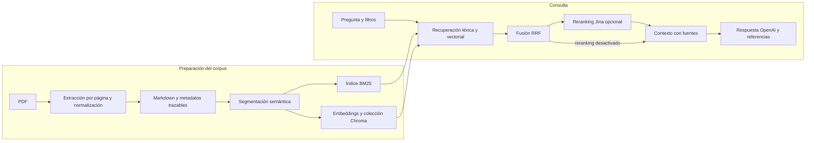

# Pipeline documental RAG empresarial

## 1. Resumen del proyecto

Este proyecto implementa un prototipo local para convertir documentos corporativos PDF en una base consultable mediante recuperación aumentada por generación (RAG). Está pensado para equipos que necesitan localizar cláusulas, procedimientos o información técnica y obtener respuestas acompañadas de referencias a los fragmentos de origen. Su aportación principal es un flujo modular que conserva estructura y metadatos desde la ingesta hasta la respuesta, combinando búsqueda por términos y por significado.

## 2. Problema y objetivos

En documentación empresarial heterogénea, una búsqueda literal puede pasar por alto una pregunta formulada con otras palabras; una respuesta generada sin evidencias también puede resultar difícil de verificar. El sistema aborda ambos problemas preparando los PDF para búsqueda y vinculando la respuesta a los pasajes recuperados. Los objetivos funcionales que se observan en la implementación son preservar información útil del documento, recuperar fragmentos complementarios, restringir resultados mediante metadatos y presentar las fuentes junto con la respuesta. El alcance es un prototipo técnico de consulta local, no una plataforma empresarial desplegada con controles de acceso completos.

## 3. Solución y arquitectura

La preparación del corpus se ejecuta antes de las consultas. Cada PDF se extrae página por página con un modelo de OpenAI y se normaliza a Markdown; el sistema registra metadatos y una huella del documento, y evita volver a procesar duplicados si está configurado para ello. Después, el contenido se segmenta en fragmentos con contexto de sección y páginas, y se preparan índices léxico y vectorial. En tiempo de consulta, ambos recuperadores producen candidatos que se fusionan y, si está habilitado, se reordenan antes de construir el contexto para el generador. La respuesta muestra referencias a los fragmentos utilizados.

## 4. Desarrollo y decisiones técnicas

La arquitectura separa el procesamiento previo de documentos de la recuperación en línea. Esto permite inspeccionar y reutilizar las salidas intermedias sin repetir la ingesta en cada pregunta. La entrada implementada son PDF: las páginas se representan como imágenes para la extracción multimodal por defecto, y el modo de envío de página en PDF también está contemplado en la configuración. OpenAI interviene asimismo en la limpieza y estructuración del texto. El código valida las páginas extraídas, registra incidencias y conserva metadatos, incluidos hash, páginas, secciones y clasificación documental.

El *chunking* analiza la jerarquía Markdown y reconoce estructuras como tablas, preguntas frecuentes y cláusulas. Combina bloques pequeños cuando encajan y divide los grandes, con un objetivo aproximado de 500 tokens, máximo de 900 y solapamiento de 80. Cada fragmento conserva contenido original y representaciones específicas para búsqueda léxica y vectorial, además de sus referencias documentales. Así se adapta la indexación sin perder el vínculo con la fuente.

La recuperación combina BM25, que favorece coincidencias terminológicas, con embeddings `text-embedding-3-large` persistidos en Chroma, que permiten buscar similitud semántica. Un tokenizador determinista para español normaliza acentos y preserva códigos y términos de negocio. Como las puntuaciones de ambos métodos no son directamente comparables, Reciprocal Rank Fusion (RRF) combina sus posiciones. El reranker `jina-reranker-v3`, consumido mediante API, puede refinar la lista de candidatos antes de seleccionar las evidencias finales; se puede desactivar. La generación usa la Responses API de OpenAI, con `gpt-5-mini` como modelo predeterminado configurable. El contexto numera los fragmentos y sus fuentes; si no se reúne el mínimo configurado de fuentes, evita la llamada al modelo y devuelve una respuesta de falta de evidencia.

La interacción está disponible por CLI y mediante una interfaz web sencilla servida localmente. Los contratos intermedios persistentes y la separación por componentes facilitan sustituir modelos o ajustar parámetros. Aunque existen configuraciones y pruebas unitarias con clientes simulados, esta versión no aporta una comparación cuantificada que permita afirmar superioridad frente a otras alternativas de recuperación o modelos. Las elecciones se presentan como decisiones de implementación.

## 5. Retos y soluciones

La variación de formato entre PDF complica conservar tablas, títulos y referencias de página. El flujo extrae por página, normaliza el contenido con instrucciones estructurales y registra avisos y comprobaciones de calidad. El segmentador utiliza encabezados y tipos de bloque para mantener contexto y evita que la búsqueda dependa de un texto plano sin estructura. Para que una respuesta pueda revisarse, los identificadores, secciones y páginas acompañan a los fragmentos durante la recuperación y se trasladan a las fuentes mostradas.

La búsqueda léxica y semántica devuelve rankings distintos, y documentos clasificados requieren restricciones adicionales. RRF permite fusionar rankings sin sumar puntuaciones incompatibles; los filtros de metadatos y nivel documental acotan los resultados. Estos niveles son metadatos de filtrado: la implementación no aporta autenticación, autorización por usuario ni auditoría de acceso.

## 6. Evaluación y resultados

El repositorio incluye pruebas unitarias para procesamiento, limpieza, segmentación, BM25, embeddings, fusión, filtros, reranking, generación y la interfaz. Varias aíslan la lógica con clientes simulados, por lo que verifican contratos y comportamientos controlados, no la calidad de respuestas en producción. También hay conjuntos de preguntas y un evaluador de recuperación que calcula Hit@k y MRR a partir de fragmentos o documentos esperados. Para esta versión no se aportan métricas agregadas contrastadas con conjunto, partición, configuración y método de evaluación identificados; por tanto, no se afirma un nivel de calidad ni una mejora cuantitativa del sistema.

## 7. Estado actual y futuras mejoras

La versión inspeccionada dispone de un flujo funcional de PDF a respuesta con fuentes, índices persistentes y opciones de consulta locales; depende de servicios externos de OpenAI y, cuando se activa el reranking, de Jina. Los formatos distintos de PDF y la operación multiusuario quedan fuera del alcance demostrado. Las siguientes mejoras con mayor valor serían versionar los conjuntos de evaluación y registrar resultados por consulta para comparar BM25, embeddings, RRF y reranking; medir por separado recuperación, fidelidad de citas y fundamentación de respuestas; y diseñar autenticación y autorización antes de tratar documentos sensibles en un entorno compartido. También conviene ampliar la validación de tablas y casos de extracción incompleta.

